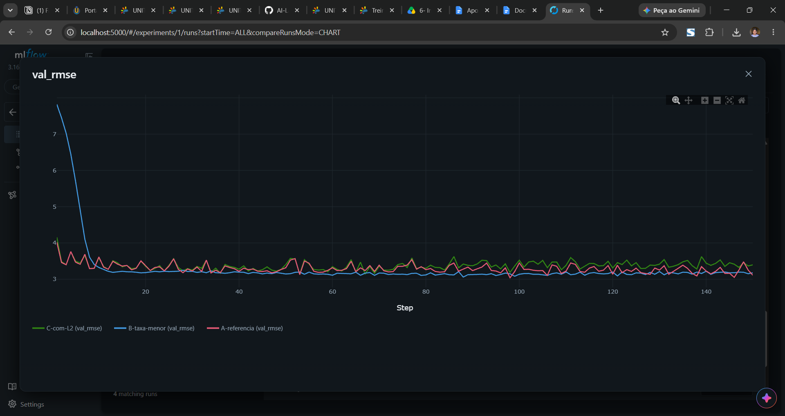
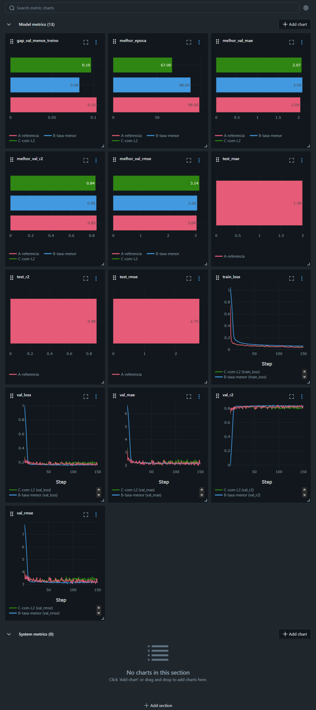
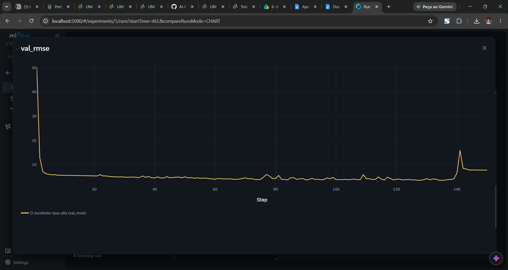
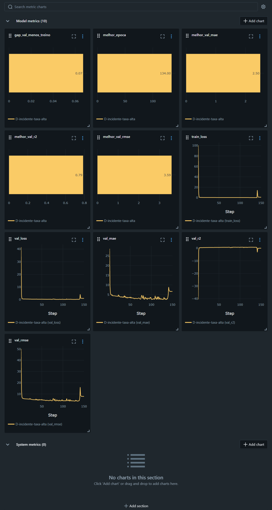

# Treinamento observável de uma MLP com MLflow — Auto MPG

Avaliação A1 da disciplina **Inteligência Artificial** (Sistemas de Informação — UNITINS, 2026/2).
Autor: **Paulo Fernando Mourão Veras Filho**.

Pipeline de treino, validação e teste de uma rede **Multi-Layer Perceptron (MLP) em PyTorch** para
prever o consumo de combustível de veículos, com rastreamento completo de cada execução no **MLflow**:
parâmetros, métricas por época, artefatos e traces das etapas.

> Vídeo de apresentação: **[link do YouTube — adicionar após a gravação]**

---

## 1. Problema

Ao treinar várias versões de uma rede neural mudando hiperparâmetros, é fácil perder o contexto de
cada resultado: qual configuração gerou qual métrica, onde está o gráfico, quais pesos correspondem
ao melhor momento do treino. Este projeto organiza o treino como um pipeline em que **cada execução é
uma run do MLflow**, ligando o desempenho às condições que o produziram
(configuração + dados + código + métricas + artefatos).

## 2. Dataset

- **Nome:** Auto MPG — UCI Machine Learning Repository (<https://archive.ics.uci.edu/dataset/9/auto+mpg>)
- **Tarefa:** regressão — prever `mpg` (consumo em milhas por galão)
- **Linhas:** 398 originais; 6 sem `horsepower` foram removidas → **392 amostras**
- **Entradas (9):**
  - numéricas, padronizadas: `cylinders`, `displacement`, `horsepower`, `weight`, `acceleration`, `model_year`
  - `origin` (1 = EUA, 2 = Europa, 3 = Japão) transformada em 3 colunas 0/1 (one-hot), por ser categórica
- **Removida:** `car_name` (texto livre, sem valor preditivo para a MLP)

## 3. Decisões metodológicas

| Decisão           | Como foi feito                                                                    | Por quê                                      |
| ----------------- | --------------------------------------------------------------------------------- | -------------------------------------------- |
| Divisão           | 70% treino / 15% validação / 15% teste (274/59/59)                                | Validação para escolher; teste reservado     |
| Estratificação    | Por quintis de `mpg`                                                              | Os três conjuntos ficam com consumo parecido |
| Pré-processamento | `StandardScaler` ajustado **só no treino** e aplicado em validação e teste        | Evita vazamento de informação                |
| Alvo              | `mpg` padronizado no treino; métricas convertidas de volta para mpg               | Treino estável; métricas interpretáveis      |
| Reprodutibilidade | Sementes fixas (`random`, `numpy`, `torch`) e ordem dos lotes com gerador semeado | Mesma config → mesmo resultado               |
| Melhor momento    | Guarda os pesos da época com menor RMSE de validação (checkpoint)                 | Identifica o ponto de melhor generalização   |
| Teste             | Usado **uma única vez**, só na run escolhida (o script bloqueia reavaliação)      | Estimativa honesta do desempenho final       |

**Critério de escolha da melhor run (definido antes de rodar):**

1. menor `melhor_val_rmse`;
2. desempate: menor distância entre as curvas de treino e validação (`gap_val_menos_treino`) e curvas mais estáveis.

## 4. Experimentos

Arquitetura (`9 → 32 → 16 → 1`, ReLU), divisão, semente (42), lote (32) e épocas (150) são iguais em
todas as runs. Cada run muda uma coisa e responde a uma pergunta:

| Run                   | Taxa  | L2   | Pergunta                                                            |
| --------------------- | ----- | ---- | ------------------------------------------------------------------- |
| A-referencia          | 0.01  | 0    | Qual é o desempenho de base?                                        |
| B-taxa-menor          | 0.001 | 0    | Uma taxa menor gera curvas mais estáveis e menor erro de validação? |
| C-com-L2              | 0.01  | 1e-5 | A regularização L2 reduz a distância entre treino e validação?      |
| D-incidente-taxa-alta | 0.5   | 0    | O que uma taxa exagerada causa nas curvas? (diagnóstico)            |

## 5. O que cada run registra no MLflow

- **Parâmetros:** taxa, L2, épocas, lote, otimizador, função de perda, arquitetura, ativação, dropout, semente, split, estratificação, dataset
- **Tags:** pergunta da run, hash do commit do Git (versão do código), arquivo de configuração, status do treino
- **Métricas por época:** `train_loss`, `val_loss` (MSE no alvo padronizado), `val_rmse`, `val_mae`, `val_r2` (em mpg)
- **Métricas finais:** `melhor_epoca`, `melhor_val_rmse`, `melhor_val_mae`, `melhor_val_r2`, `gap_val_menos_treino`
- **Artefatos:** curva de aprendizado, previsto × real e resíduos da validação, resumo do pré-processamento (JSON), config usada, pesos da melhor época e o modelo PyTorch
- **Dataset:** registrado na aba _Datasets_ da run
- **Trace:** span `pipeline_treino` com os filhos `preparar_dados`, `treinar` e `validar` (entradas, saídas, duração e erros)

## 6. Como reproduzir

Pré-requisitos: [Miniconda](https://docs.conda.io/en/latest/miniconda.html) e Git.

```bash
# 1. Clonar e entrar na pasta
git clone https://github.com/SEU-USUARIO/ia-a1-mlp-auto-mpg.git
cd ia-a1-mlp-auto-mpg

# 2. Criar e ativar o ambiente isolado
conda env create -f environment.yml
conda activate ia-a1-mlp

# 3. (Só se data/auto-mpg.csv não existir) baixar o dataset
python baixar_dados.py

# 4. Rodar as runs A, B e C com um único comando (acrescente --incluir-incidente para a D)
python rodar_experimentos.py --incluir-incidente

# 5. Abrir a interface do MLflow em http://localhost:5000
mlflow ui --backend-store-uri sqlite:///mlflow.db

# 6. Depois de escolher a melhor run pela validação, avaliar no teste (uma única vez)
python avaliar_teste.py --run-name NOME-DA-RUN-ESCOLHIDA
```

Para rodar só uma configuração: `python treinar.py --config configs/run_a_referencia.yaml`.
Para criar um novo experimento, basta copiar um YAML de `configs/` e mudar os valores — o código não precisa ser editado.

## 7. Estrutura

```
├── configs/                 # uma configuração YAML por run
├── data/auto-mpg.csv        # dataset versionado
├── docs/img/                # prints usados neste README
├── src/
│   ├── dados.py             # carga, divisão estratificada, scalers, one-hot
│   ├── modelo.py            # classe MLP em PyTorch
│   ├── treino.py            # laço de treino, checkpoint e métricas
│   ├── graficos.py          # curva, previsto × real, resíduos
│   └── utils.py             # config, sementes, hash do commit
├── treinar.py               # executa UMA configuração com rastreamento
├── rodar_experimentos.py    # executa todas as configurações
├── avaliar_teste.py         # avaliação única no teste da run escolhida
├── baixar_dados.py          # baixa o CSV do UCI
├── environment.yml / requirements.txt
```

## 8. Resultados

Valores na melhor época de cada run (validação, 59 amostras). Todas as runs foram executadas duas vezes a partir
de um banco vazio e produziram **exatamente os mesmos números** (sementes fixas + commit registrado).

| Run                   | Melhor época | val RMSE (mpg) | val MAE (mpg) | val R²    | Gap val − treino |
| --------------------- | ------------ | -------------- | ------------- | --------- | ---------------- |
| A-referencia          | 98           | **3,039**      | **2,038**     | **0,848** | 0,104            |
| B-taxa-menor          | 88           | 3,059          | 2,088         | 0,845     | **0,083**        |
| C-com-L2              | 67           | 3,140          | 2,068         | 0,837     | 0,097            |
| D-incidente-taxa-alta | 134          | 3,590          | 2,499         | 0,787     | —                |



<details><summary>Painel completo das métricas (A, B e C)</summary>



</details>

### Respostas às perguntas de cada experimento

- **A — desempenho de base:** a MLP erra em média cerca de 3 mpg e explica aproximadamente 85% da variação do consumo (R² 0,85).
- **B — taxa menor (0.001):** **curvas mais estáveis, sim; erro menor, não.** Da época 50 à 150, o val RMSE da B fica entre 3,14 e 3,18,
  enquanto o da A oscila entre 3,30 e 3,45 antes de cair no fim. O melhor erro da B (3,059) é praticamente igual ao da A (3,039).
  A B também teve a menor distância entre treino e validação (0,083).
- **C — L2 de 1e-5:** **não houve efeito relevante.** O gap caiu de 0,104 para 0,097 (diferença desprezível) e o erro piorou levemente.
  Entre as épocas 50 e 100 o erro de validação da C sobe (3,40 → 3,52) enquanto o treino continua caindo — sinal de sobreajuste que
  esse valor de L2 não conteve. Hipótese para trabalho futuro: testar valores maiores (1e-4, 1e-3).

### Escolha da run

**Run escolhida: A-referencia.** Pelo critério definido antes da execução (menor val RMSE na melhor época), a A vence.
Ressalva: a diferença para a B é de apenas 0,02 mpg em 59 amostras, o que está dentro do ruído estatístico — na prática as
duas são equivalentes. O gráfico de val RMSE por época reforça isso: o melhor valor da A é um ponto baixo isolado de uma curva que
oscila entre cerca de 3,05 e 3,55, enquanto a B permanece de forma constante perto de 3,15 a partir da época 15, abaixo da A na maior
parte do treino. Ou seja, a B é a configuração mais confiável, e a A venceu o critério por uma oscilação favorável. Ainda assim,
o critério definido antes da execução foi mantido, para não escolher o modelo depois de ver os resultados.

### Avaliação final no teste (uma única vez, só na run A)

| Métrica | Teste (59 amostras) |
| ------- | ------------------- |
| RMSE    | **2,752 mpg**       |
| MAE     | **1,993 mpg**       |
| R²      | **0,877**           |

O resultado no teste ficou próximo (ligeiramente melhor) do obtido na validação, o que indica que o modelo generaliza para
dados nunca vistos. A pequena diferença é esperada com conjuntos de 59 amostras.

## 9. Diagnóstico do incidente (run D)



<details><summary>Painel completo das métricas da run D</summary>



</details>

- **Sintoma:** na época 1 a perda de treino explode (train_loss ≈ 100; erro de validação de 50 mpg). Entre as épocas 25 e 125
  o modelo se recupera de forma instável (erro entre 3,7 e 5,2 mpg, sempre pior que A, B e C). Perto da época 140 ele **colapsa**:
  train_loss ≈ 1,0 e val R² ≈ 0. Como o alvo está padronizado, perda 1,0 e R² 0 significam que o modelo passou a prever
  **sempre a média** do consumo, para qualquer carro.
- **Hipótese:** a taxa de aprendizado 0,5 (50 vezes a da run A) faz cada atualização "passar do ponto" do mínimo. Um desses
  passos grandes empurrou os neurônios ReLU para a região em que só produzem zero ("neurônios mortos"); sem sinal passando
  pelas camadas ocultas, sobra apenas o viés da saída, que converge para a média.
- **Verificação (nova run):** a run A é idêntica à D exceto pela taxa (0,01) e não apresenta explosão nem colapso.
  Isso confirma que a taxa de aprendizado é a causa.
- **Observação:** o checkpoint salvou os pesos da época 134, anterior ao colapso. Sem ele, o modelo final da D seria inútil —
  isso mostra por que guardar o melhor momento do treino importa.

## 10. Uso de IA generativa

Conforme exigido pela atividade, foi utilizada IA generativa (Claude, da Anthropic) como apoio para:
auxiliar nas etapas de estrutura do pipeline, código, revisão do README, juntando com o meu conhecimento e o que foi feito por mim, por exemplo, a execução, análise dos resultados, escolha da run, gravação do vídeo, foi possível criar esse artefato de A1 com muita qualidade e informação.
